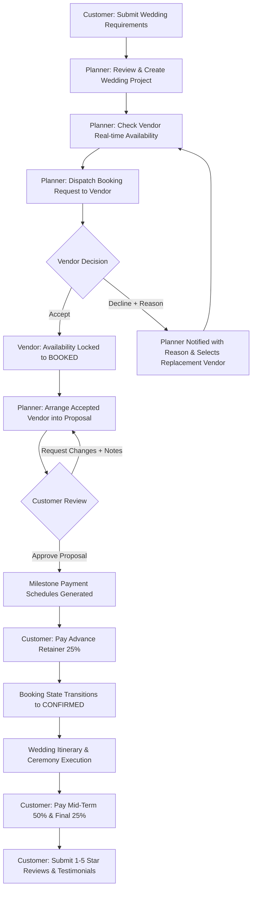

# Wedding Planner and Vendor Coordination Platform (WPVCP)
### *Vows & Veils — Enterprise Wedding Concierge & Coordination Suite*

A complete, professional, real-world full-stack web application designed for comprehensive wedding management, vendor collaboration, client approval workflows, and milestone financial tracking.

---

## 🏛️ System Overview & Architecture

Vows & Veils strictly implements the enterprise coordination workflow:

$$\text{Customer} \longrightarrow \text{Planner} \longrightarrow \text{Vendor} \longrightarrow \text{Planner} \longrightarrow \text{Customer}$$

Centered around **three distinct user roles**:

1. **PLANNER (Lead Wedding Planner & Administrator)**
   - Oversees wedding projects, manages customer requirement sheets, checks vendor calendars in real-time, dispatches requests, reviews vendor accept/decline responses, manages Selected Vendors, administers Service Management taxonomy, schedules ceremony events, controls itemized budgets, monitors payments, issues GST invoices, resolves Support Desk tickets, and communicates via real-time messaging.
2. **VENDOR (Specialized Wedding Partners)**
   - Manages service catalog packages, blocks dates on their availability calendar, reviews booking requests with mandatory decline reasons, views confirmed client engagements under strict data isolation, tracks milestone disbursements, views assigned schedules, and replies to client testimonials.
3. **CUSTOMER (Engaged Couples & Families)**
   - Submits wedding vision, guest count, and budgets, collaborates with their assigned planner, approves or requests changes on arranged vendor teams, tracks live booking progress with exact service-wise amounts, makes milestone payments (Advance, 2nd, Final), inspects GST invoices, tracks synchronized budgets, opens support inquiries, and submits verified reviews.

> **Crucial Workflow Integrity**: Customers never directly contract vendors. All inquiries, proposals, and contracts flow through the certified **Wedding Planner**, ensuring curated quality, negotiated pricing, and escrow payment protection.



---

## 💻 Technology Stack

- **Database**: MySQL 8.0 (28 normalized tables with foreign keys, cascades, indexes, and full constraints).
- **Backend**: Node.js, Express.js, `mysql2/promise` connection pooling, JWT auth, `bcryptjs` password hashing, `express-rate-limit` endpoint protection, `google-auth-library` OAuth verification, `multer` document handling, and role-based middleware.
- **Frontend**: React 18, Vite, React Router v6, Axios with interceptors, Lucide React icons, and Vanilla CSS design tokens.
- **Accessibility & Styling**: High-contrast Light/Dark mode themes, 4 dynamic font sizes (S/M/L/XL), responsive layouts, and full 6-language translation dictionary (English, Tamil, Hindi, Malayalam, Telugu, Kannada).
- **Chatbot & Assistance**: Contextual floating AI concierge answering live database inquiries on weddings, bookings, budgets, and vendors.

---

## 🔐 Google OAuth 2.0 Setup Guide

The application connects to **official Google OAuth 2.0 / Google Identity Services** with account selection (`prompt=select_account`). **The application NEVER requests or stores Gmail passwords.**

### Step 1: Create Credentials in Google Cloud Console
1. Visit the [Google Cloud Console](https://console.cloud.google.com/).
2. Create or select a project.
3. Navigate to **APIs & Services** → **Credentials**.
4. Configure the **OAuth Consent Screen** (External or Internal).
5. Click **Create Credentials** → **OAuth client ID**:
   - Application type: **Web application**
   - Name: `Wedding Planner Platform`
   - **Authorized JavaScript origins**:
     - `http://localhost:5173`
   - **Authorized redirect URIs**:
     - `http://localhost:5000/api/auth/google/callback`
6. Copy your **Client ID** and **Client Secret**.

### Step 2: Configure Backend Environment Variables
In `backend/.env`:
```env
GOOGLE_CLIENT_ID=your-client-id.apps.googleusercontent.com
GOOGLE_CLIENT_SECRET=your-client-secret
GOOGLE_CALLBACK_URL=http://localhost:5000/api/auth/google/callback
```

### Flow Breakdown:
1. User clicks **Continue with Google**.
2. Frontend requests `/api/auth/google/url`.
3. If credentials are configured, browser redirects to Google's official account chooser (`accounts.google.com`) with `prompt=select_account`.
4. User selects account or enters Gmail on Google's secure domain.
5. Google redirects to `http://localhost:5000/api/auth/google/callback?code=...`.
6. Backend exchanges authorization code with Google for tokens and authenticates user profile.
7. User is linked in MySQL (or created as a `CUSTOMER` by default) and redirected back to the platform dashboard with an application JWT.

---

## 🔑 Pre-Configured Test Accounts

All demo accounts are initialized with password: **`password123`**

| Role | Name | Email | Password | Primary Responsibilities |
| :--- | :--- | :--- | :--- | :--- |
| **PLANNER** | Priya Sharma | `planner@wedding.com` | `password123` | Lead Wedding Planner, Project Architect |
| **PLANNER** | Arjun Kapoor | `arjun.planner@wedding.com` | `password123` | Senior Concierge & Vendor Director |
| **VENDOR** | Vikram Rathore (Pixel & Petals) | `shutter@wedding.com` | `password123` | Candid & Drone Wedding Photography |
| **VENDOR** | Ananya Roy (Royal Mandap) | `floral@wedding.com` | `password123` | Wedding Venue Decor & Stage Styling |
| **VENDOR** | Chef Rajesh Nair (Annapoorna) | `royalcatering@wedding.com` | `password123` | Authentic Multi-Cuisine Banquets |
| **VENDOR** | DJ Rohit Roy | `djbeats@wedding.com` | `password123` | DJ, Sound, Sangeet & LED Floor |
| **CUSTOMER** | Rahul & Anita Verma | `rahul.anita@gmail.com` | `password123` | Royal Palace Wedding (Bangalore) |
| **CUSTOMER** | Rohit & Sneha Kulkarni | `rohit.sneha@gmail.com` | `password123` | Coastal Beachside Wedding (Chennai) |
| **CUSTOMER** | Siddharth & Pooja Hegde | `siddharth.pooja@gmail.com` | `password123` | Heritage Temple Ceremony (Madurai) |

---

## 🚀 Step-by-Step Setup & Installation

### 1. Prerequisites
- **Node.js**: v18 or higher (`node -v`)
- **MySQL Server**: v8.0 running locally on port 3306 (`mysql --version`)

### 2. Configure Backend Environment
In `backend/.env`:
```env
PORT=5000
NODE_ENV=development

DB_HOST=localhost
DB_PORT=3306
DB_NAME=wedding_planner
DB_USER=root
DB_PASSWORD=your_mysql_password

JWT_SECRET=wpvcp_production_super_secret_jwt_key_2026
JWT_EXPIRES_IN=7d

GOOGLE_CLIENT_ID=
GOOGLE_CLIENT_SECRET=
GOOGLE_CALLBACK_URL=http://localhost:5000/api/auth/google/callback
```

### 3. Initialize MySQL Database
```bash
# Create database and import schema + seed
mysql -u root -p -e "CREATE DATABASE IF NOT EXISTS wedding_planner;"
mysql -u root -p wedding_planner < database/schema.sql
mysql -u root -p wedding_planner < database/seed.sql
```

### 4. Run the Backend Server
```bash
cd backend
npm install
npm run dev
# Backend starts listening at http://localhost:5000
# Health check available at: http://localhost:5000/api/health
```

### 5. Run the Frontend Server
In a new terminal:
```bash
cd frontend
npm install
npm run dev
# Frontend web application accessible at http://localhost:5173
```

---

## 📁 Repository Structure

```
wedding-planner-platform/
├── database/
│   ├── schema.sql           # 28 normalized SQL tables
│   ├── seed.sql             # Realistic wedding data, users, bookings, payments, schedules
│   └── README.md            # Database documentation
├── backend/
│   ├── config/              # MySQL connection pool & JWT sign/verify
│   ├── controllers/         # Dedicated REST controllers
│   ├── middleware/          # Rate limiters, JWT auth, role validation
│   ├── routes/              # Express API routers
│   ├── services/            # Notification & Chatbot query services
│   ├── utils/               # Pagination, sorting, query helpers
│   ├── .env.example         # Backend environment configuration
│   └── server.js            # Main Express application entry point
├── frontend/
│   ├── src/
│   │   ├── components/      # Badges, Modals, StatCards, Sidebar, Header, Chatbot, etc.
│   │   ├── context/         # AuthContext, ThemeContext, LanguageContext, ToastContext
│   │   ├── layouts/         # Role-protected DashboardLayout
│   │   ├── pages/
│   │   │   ├── auth/        # Login (Google OAuth & Local), Register, Forgot Password
│   │   │   ├── common/      # Settings, Messages, Notifications, Reports
│   │   │   ├── customer/    # Booking Status, Budget Tracker, Payments, Support, etc.
│   │   │   ├── planner/     # Selected Vendors, Services, Schedule, Budget, Support, etc.
│   │   │   ├── public/      # Landing Page
│   │   │   └── vendor/      # Availability, Requests, Customers, Categories, Schedule, etc.
│   │   ├── styles/          # index.css design tokens & responsive CSS
│   │   ├── App.jsx          # Complete routing assembly
│   │   └── main.jsx         # Context provider bootstrapping
│   ├── index.html
│   ├── vite.config.js
│   └── package.json
├── .gitignore
└── README.md
```

---

## 📦 Exporting the Platform

To create the clean distribution archive:
```bash
# From workspace root
zip -r wedding-planner-platform.zip . -x "**/node_modules/*" "**/.git/*" "**/dist/*" "**/.DS_Store"
```
